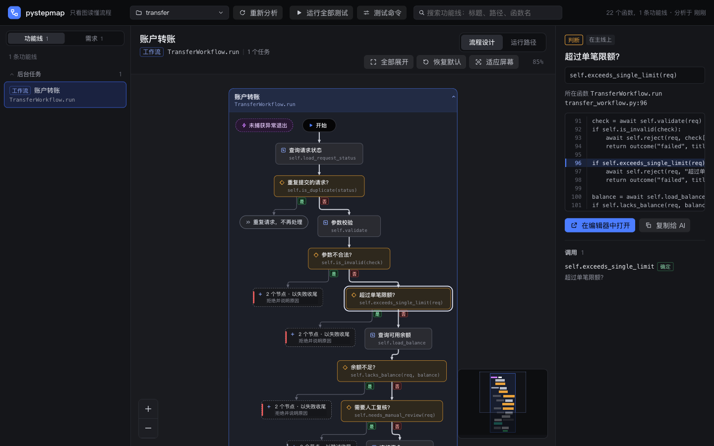
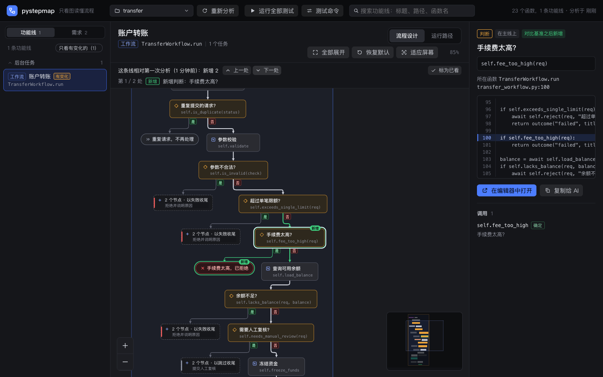
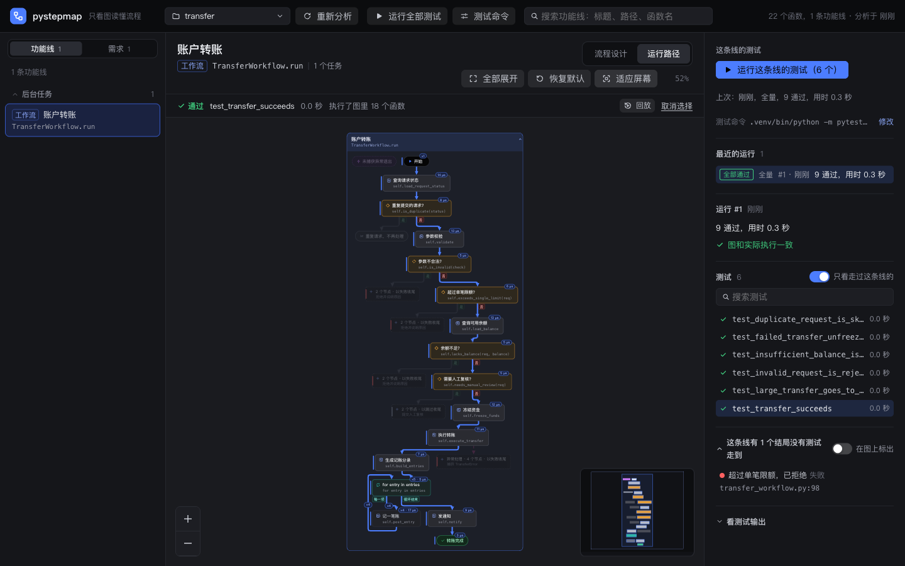
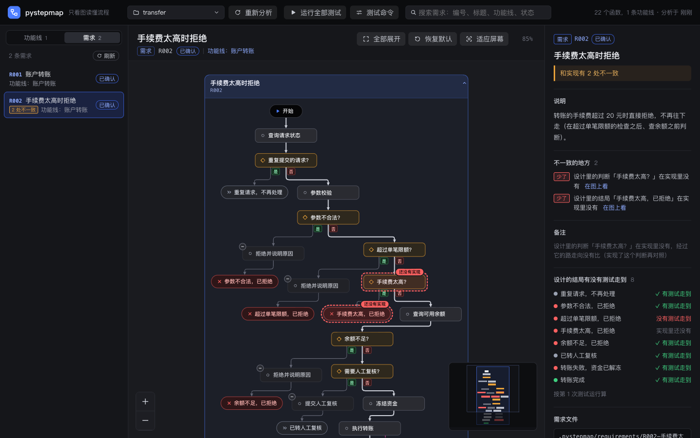

# pystepmap

**把 Python 后端代码画成业务流程图。** 每个接口、后台任务、命令各画成一条"功能线"：先做什么 → 判断什么 →
在什么情况下以什么结局结束。让 AI 替你写后端时，不读代码也能看懂它写了什么流程、改了哪里、测试走到了哪些路。



> 截图里的项目是仓库自带的示例 [`examples/transfer`](examples/transfer/)（账户转账）。

## 它能做什么

### 看懂每条功能线

代码不需要任何标记。pystepmap 静态分析整个项目，认出入口（FastAPI / Flask 的接口，taskiq / Celery / DBOS 的任务和
工作流，click / typer 的命令，脚本），把每个入口画成一张流程图：步骤、判断、循环、捕获异常，以及成功、跳过、失败、
未捕获异常这几类结局。点节点看源码、一键在编辑器里打开；步骤可以就地展开，看它调用的函数里又做了什么。功能线的标题和
分组也可以在平台上手工改。

### 代码改了：标出流程哪里变了



代码改了以后，平台提示"图可能过期"。重新分析后，标出流程相对上次看过时新增、删除、改动了哪些步骤、判断和结局，
可以逐处定位，看完标为已看。只改了格式、注释时，不会多标任何东西。

### 跑测试：看真实走过的路



在平台上填一条测试命令、点一下运行：平台挂上记录插件跑 pytest（不改项目文件），之后可以回看任一测试走过的节点和
每步耗时、失败的测试停在哪里，列出没有任何测试走到的结局，并自动核对图和实际执行是否一致。

### 先写需求，再对照实现



需求是项目里的一个 Markdown 文件，用几行中文写出改完之后的流程，例如：

```text
判断：手续费太高？
  是：
    结局（失败）：手续费太高，已拒绝
```

平台把设计画成图，和代码的流程逐项对照：没实现的、多出来的、结局类别写错的（该拒绝的写成了跳过）、位置放错的
（该在扣款之前判断的放到了之后），各标出来。用 OpenSpec 管需求的项目，把流程写进变更的 `design.md` 就行。

### 在 Claude Code 里用

`pystepmap mcp` 把同一份数据交给 Claude Code。在你的项目里可以直接对 Claude 说：

- "用 pystepmap 分析这个项目，把每条功能线讲给我听"
- "我要加 XXX，先把改完之后的流程写成需求给我看"
- "实现完对照需求，告诉我哪里不一样"
- "哪些结局还没有测试走到？"

AI 改代码之前先查这一行在哪条流程的哪一步，改完重新分析，把流程变了什么告诉你。

## 特点

- **分析只读**：分析不导入、不执行被分析项目的代码。测试只在你在平台上点运行时才跑；你在平台上打开"允许 AI
  运行单条功能线的测试"后，AI 也能经 MCP 请平台跑一条线的测试。MCP 里会写项目文件的只有保存需求这一个工具。
- **不用改代码**：没有标记也能分析。想要全中文的节点标题、想让 AI 写的流程遵守编排约束时，再用
  [约束套件](docs/kit.md) 加标记。
- **引擎只用标准库**：分析引擎没有第三方依赖。
- **数据都在本机**：平台只监听 `127.0.0.1`，数据存在 `~/.pystepmap/`。

## 快速开始

需要 Python 3.12 及以上和 [uv](https://docs.astral.sh/uv/)；用平台看图还需要 Node.js 20.19+ 或 22.12+（打包前端用）。

```bash
git clone https://github.com/xiaoyin1993/pystepmap.git
cd pystepmap
uv sync
```

### 1. 打开平台，看示例项目

```bash
cd web && npm install && npm run build && cd ..
cp -R examples/transfer ~/transfer-try   # 在拷贝上试，仓库里这份保持不动
uv run pystepmap serve                   # 自动打开 http://127.0.0.1:5179
```

点"添加第一个项目"，填 `~/transfer-try`。照 [`examples/transfer/README.md`](examples/transfer/README.md) 可以试一遍
改一处流程看差异、运行测试看路径。

### 2. 接入 Claude Code

在 pystepmap 仓库根目录运行一次：

```bash
claude mcp add --scope user pystepmap -- uv run --project "$(pwd)" pystepmap mcp
```

之后在任何项目里打开 Claude Code 都能用；输入 `/mcp` 看到 pystepmap 就是连上了。

### 3. 只用命令行

```bash
uv run pystepmap analyze /path/to/project -o graph.json   # 输出图，摘要打印到终端
uv run pystepmap check /path/to/project                   # 编排约束检查
```

## 认得出哪些入口

| 入口 | 认的是什么 |
|---|---|
| 接口 | FastAPI、Flask（Quart、Sanic、Bottle 同样的写法）的路由 |
| 后台任务、工作流 | taskiq、Celery、DBOS 的任务和工作流，pystepkit 的 `@workflow` |
| 命令行 | click / typer 的子命令 |
| 框架来调的函数 | 定时任务、机器人这类挂着框架装饰器、项目里又没有人调用的函数 |
| 脚本 | `if __name__ == "__main__":` 里调用的函数 |
| 注释点名 | 在 `def` 上面加一行 `# pystepmap: 入口 每日对账` |

一个都没有时，把没有人调用的顶层函数当入口。细节见 [入口是怎么认出来的](docs/cli.md#入口是怎么认出来的)。

## 现在的限制

- 只分析 Python。
- 代码全写在文件顶层、没有放进函数里的脚本画不出流程（让 AI 把过程放进 `def main()`）。
- 没有标记时，节点的标题是代码原文（`total > 5000`）或函数的文档注释；想要全中文的标题，让 AI 按
  [约束套件](docs/kit.md) 的写法打标记。
- 还没有发布到 PyPI：从源码仓库安装和运行。

## 文档

| 文档 | 讲什么 |
|---|---|
| [平台](docs/platform.md) | 启动选项、过期提示和流程差异、变更记录、运行测试和运行路径、需求和 OpenSpec、数据目录 |
| [在 Claude Code 里使用](docs/claude-code.md) | MCP 的配置和十五个工具 |
| [命令行和记录插件](docs/cli.md) | analyze / check / serve / mcp / verify、分析配置、入口识别、哪些调用是步骤、pytest 记录插件 |
| [约束套件](docs/kit.md) | 流程标记、四条约束、编辑后的钩子和提交前检查、装进别的项目 |
| [开发](docs/development.md) | 仓库结构、跑测试、改前端时的开发模式 |
| [图的格式](docs/graph-schema.md) | `pystepmap analyze` 输出的 JSON 字段 |

## 仓库结构

- `core/`：分析引擎、命令行 `pystepmap`、pytest 记录插件
- `kit/pystepkit/`：给业务代码打流程标记的装饰器，零依赖、运行时零开销
- `server/`：本机平台的后端和给 Claude Code 用的 MCP 服务
- `web/`：平台的前端（Vue 3 + Vue Flow）

## 许可证

MIT，见 [LICENSE](LICENSE)。可以自由使用、修改、分发和商用，只要求在副本里保留版权声明和这份许可。
